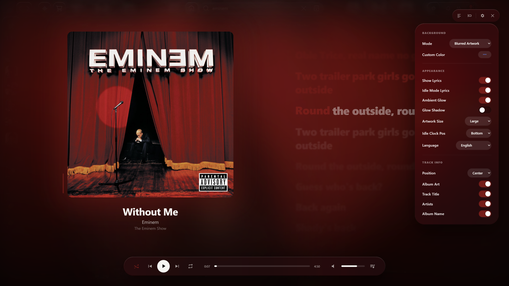

# 🎵 Fullscreen Reloaded — Spicetify Extension

> A premium Apple TV / visionOS–inspired Spotify fullscreen experience with Liquid Glass design. Updated & optimized for **Spotify v1.3.6** & modern Spicetify.



---

## ✨ Features

### 🎨 Background Modes
| Mode | Description |
|------|-------------|
| Solid | Plain dark background |
| Gradient | Soft gradient derived from album colors |
| Dynamic Gradient | Live color transitions on track change |
| Blurred Artwork | Blurred album art as background |
| Artwork | Full-resolution cover art background |
| Darkened Artwork | Darkened cover art overlay |
| Custom Color | Pick any color you want |

### 🎤 Lyrics
- **Multi-provider fallback chain:** Spotify Native Lyrics (1.3.6 compatible with Session Token fallback) + LRCLIB (open provider) + Apple Music
- **Word-synced:** Highlights word by word in real time
- **Line-synced:** Highlights line by line
- **Unsynced:** All lyrics displayed cleanly, not clickable
- Click any synced lyric line to seek to that moment
- First line is visible before the song's first timestamp
- **Smooth scrolling** — silky auto-scroll follows the active line
- "Resume Sync" button to re-enable auto-scroll after manual scrolling
- No lyrics found → album art centers automatically
- Lyrics truly unavailable → 🎵 **Instrumental Animation** (animated equalizer bars)
- `♪` / `🎶` lines → large bouncing music note icon

### 🎛️ Bottom Bar (Liquid Glass)
- Shuffle, Previous, Play/Pause, Next, Repeat controls
- Click or drag the progress bar to seek
- Volume via scroll wheel ±5% on the volume area
- Volume bar click & drag support
- Queue button (supports Spotify 1.3.6 queue navigation)

### 📺 Picture-in-Picture (PiP)
- Hit the PiP button in the top bar to float the album art in a mini window
- PiP image updates automatically when the track changes
- Document Picture-in-Picture API + legacy canvas video fallback

### 🌐 Multilingual UI (i18n)
- Full **English** 🇬🇧 and **Turkish** 🇹🇷 support
- **Auto mode:** Follows Spotify's own language setting
- Manually override from Settings at any time

### 🌙 Idle (Cinema) Mode
- Activates after ~2.5 seconds of no mouse movement
- Album art centers and enlarges
- Clock appears (Top or Bottom position configurable)
- Any mouse movement returns to normal mode

### ⏰ Clock
- Shown during idle mode
- Configurable position: Top / Bottom
- Large, legible font with tabular numerals

### 🃏 Up Next Card
- Appears in the bottom-right corner as the current track nears its end
- Shows the next track's title, artist, and album art (using Spotify 1.3.6 PlayerAPI)
- Click to skip to the next track

### 🖼️ Album Artwork
- Roundness (border radius) setting
- Size: Small / Medium / Large
- Ambient glow toggle
- Drop shadow toggle
- Dual-layer crossfade animation on track change

### ℹ️ Track Info
- Position: Left / Center / Right
- Toggle Album Art visibility
- Toggle Track Title visibility
- Toggle Artists visibility (multi-artist tracks fully supported)
- Toggle Album Name visibility

---

## 📁 Project Architecture (Modular Structure)

The extension has been re-architected into modular source files with zero-dependency build support:

```
Fullscreen-Reloaded/
├── manifest.json                  # Spicetify extension manifest
├── package.json                   # NPM package descriptor & build scripts
├── build.js                       # Zero-dependency Node.js compiler & bundler
├── fullscreen-reloaded.js         # Production bundle loaded by Spicetify
├── preview.png
├── README.md
└── src/
    ├── index.js                   # Extension entry point & lifecycle
    ├── App.js                     # Main application coordinator (DOM, ticker, hotkeys, PiP)
    ├── styles/                    # Modular Liquid Glass CSS
    │   ├── variables.css          # Design tokens & CSS variables
    │   ├── background.css         # Background layers, scrim, tint
    │   ├── stage.css              # Stage layout, album art, progress ring, metadata
    │   ├── lyrics.css             # Synced lyrics, active lines, word highlights, equalizer
    │   ├── controls.css           # Liquid glass bottom dock, seek bar, volume
    │   ├── topbar.css             # Floating pill topbar
    │   ├── settings.css           # Settings dialog & controls
    │   ├── ambient.css            # Ambient glow orbs & particles
    │   ├── upnext.css             # Up next card
    │   └── idle.css               # Idle cinema mode, clock, responsive styles
    ├── components/                # UI Components
    │   ├── TopBar.js
    │   ├── BottomDock.js
    │   ├── LyricsView.js
    │   ├── BackgroundManager.js
    │   ├── AmbientManager.js
    │   ├── Clock.js
    │   ├── UpNextCard.js
    │   └── SettingsModal.js
    ├── services/                  # Business logic & APIs
    │   ├── SpicetifyBridge.js     # Spotify 1.3.6 API bridge (Player, Platform, Session, Queue)
    │   ├── LyricsService.js       # Multi-provider lyrics resolver
    │   ├── AppleMusicAuth.js      # Apple Music token scraper & MusicKit JS
    │   ├── ColorExtractor.js      # Canvas quantization color palette generator
    │   └── providers/
    │       ├── BaseLyricsProvider.js
    │       ├── SpotifyLyricsProvider.js  # Color-lyrics (CosmosAsync + Session token fetch)
    │       ├── LrclibLyricsProvider.js   # Open LRCLIB with retries & title cleaning
    │       └── AppleMusicLyricsProvider.js
    └── utils/                     # Helpers & utilities
        ├── dom.js                 # DOM builder helpers
        ├── formatters.js          # Time formatters & image URL resolver
        ├── i18n.js                # Multi-language dictionaries (EN, TR)
        ├── icons.js               # Apple TV-inspired SVG icons
        ├── parsers.js             # TTML & LRC lyrics parsers
        └── settings.js            # Settings manager with persistence
```

---

## 🛠️ Development & Building

You can edit files inside `src/` and compile them into `fullscreen-reloaded.js`:

```bash
# Build once (zero external dependencies required)
npm run build
# or
node build.js

# Watch mode (automatically rebuilds on file save)
npm run watch
# or
node build.js --watch
```

---

## 📦 Installation

1. Make sure [Spicetify](https://spicetify.app/) is installed.
2. Copy `fullscreen-reloaded.js` to your Spicetify Extensions folder:
   ```powershell
   # Windows
   copy fullscreen-reloaded.js "$env:APPDATA\spicetify\Extensions\fullscreen-reloaded.js"
   ```
3. Enable and apply the extension:
   ```powershell
   spicetify config extensions fullscreen-reloaded.js
   spicetify apply
   ```

---

## ⌨️ Usage

| Action | Description |
|--------|-------------|
| Click the fullscreen icon in Spotify | Open fullscreen mode (intercepts Spotify 1.3.6 button) |
| `F` or `F11` | Open / close fullscreen mode |
| `Esc` | Close fullscreen mode |
| Scroll wheel (on volume area) | Volume ±5% |
| Click a lyric line | Seek to that moment (synced tracks only) |
| PiP button | Open / close floating mini window |
| Gear button | Open Settings panel |

---

## 📋 Compatibility

- **Spotify Desktop:** Tested and optimized for **Spotify v1.3.6+** (also backwards-compatible with 1.2.x)
- **Spicetify:** v2.x+
- **Platforms:** Windows, macOS, Linux
