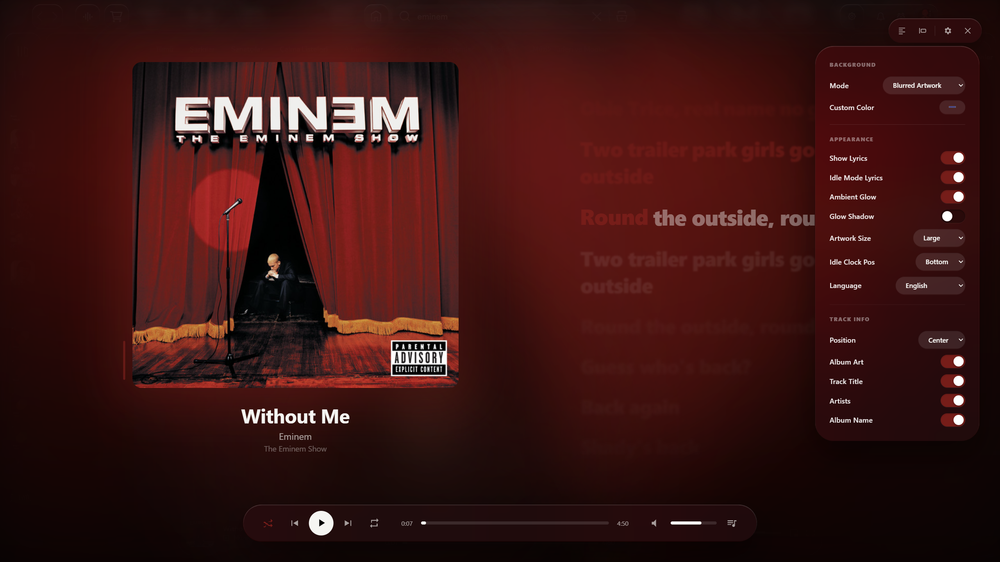

# 🎵 Fullscreen Reloaded — SpotiKit Extension

> Apple TV / visionOS–inspired Spotify fullscreen experience with Liquid Glass design, word-synced lyrics, Mood Atmosphere, FullLyrics Creator Studio, and Picture-in-Picture support. Built for **SpotiKit** and **Spotify v1.3.5 – 1.3.9**.



---

## ✨ Features

### 🎨 Background Modes & Mood Atmosphere
| Mode | Description |
|------|-------------|
| Solid | Plain dark background |
| Gradient | Soft gradient derived from album colors |
| Dynamic Gradient | Live color transitions on track change |
| Blurred Artwork | Blurred album art as background |
| Artwork | Full-resolution cover art background |
| Darkened Artwork | Darkened cover art overlay |
| Custom Color | Pick any color you want |

- **Mood Atmosphere (`AudioMoodEngine.js`):** Analyzes track audio features (`auto`, `energetic`, `melancholic`, `latenight`, `dreamy`, or `off`) and drives ambient lighting and **Beat-Reactive** pulse intensity (`normal`, `intense`, `off`) via `SpotiKit.Audio.analysis`.

### 🎤 Lyrics & FullLyrics Creator Studio
- **Multi-provider fallback chain:** Spotify Native Lyrics + Spicy Lyrics (`SpicyLyricsProvider.js`) + LRCLIB + Genius + Apple Music
- **Word-synced & Waterfall Lyrics:** Real-time word/syllable highlighting with smooth **Waterfall Lyrics** animation (`normal`, `intense`, `off`)
- **Line-synced & Unsynced:** Click any synced lyric line to seek, or customize unsynced auto-scroll speed
- **Interlude Dots & Duet/Background Vocals:** Visual instrumental interlude indicators and distinct styling for background vocals
- **FullLyrics Creator Studio (`FullLyricsCreator.js`) & Custom Sync (`CustomSyncStorage.js`):** Create, edit, time-sync, import, and export custom lyrics directly inside the fullscreen overlay
- **Smooth scrolling & Resume Sync:** Auto-scroll follows the active line and can be resumed with a single click after manual scrolling
- **Instrumental & Missing Lyrics Handling:** Centers artwork when no lyrics exist and displays an animated equalizer for instrumental tracks

### 🎛️ Bottom Bar (Liquid Glass)
- Shuffle, Previous, Play/Pause, Next, Repeat controls
- Click or drag the progress bar to seek
- Volume via scroll wheel (±5%) or click & drag
- Queue button integrated with SpotiKit navigation

### 📺 Picture-in-Picture (PiP)
- Float the current artwork in a mini window from the top bar
- Automatically updates artwork on track changes
- Uses the Document Picture-in-Picture API with canvas video fallback

### 🌐 Multilingual UI (i18n)
- Full **English** and **Turkish** support
- **Auto mode** follows Spotify's locale via `SpotiKit.Locale`
- Live language switching from Settings without reloading Spotify

### 🌙 Idle (Cinema) Mode & Clock
- Activates after inactivity when enabled
- Enlarges/centers artwork while optionally keeping lyrics visible
- Configurable **Clock** position (`Top`, `Bottom`, or `None`) with tabular numerals

### 🃏 Up Next Card
- Appears in the bottom-right corner as the current track nears its end
- Displays the next track's title, artist, and artwork from `SpotiKit.Queue`
- Click to skip immediately to the next track

### 🖼️ Album Artwork & Track Info
- Configurable artwork size (`Small` / `Medium` / `Large`), corner roundness, ambient glow, drop shadow, and dual-layer crossfade
- Track metadata position (`Left` / `Center` / `Right`) and per-field visibility toggles (Artwork, Title, Artist, Album)

---

## 📁 Project Architecture

```
Fullscreen-Reloaded/
├── spotikit.json                  # SpotiKit extension manifest
├── spotikit.d.ts                  # Official SpotiKit TypeScript declarations
├── jsconfig.json                  # Editor JS/TS config for SpotiKit types
├── package.json                   # NPM metadata, build, test & spotikit-kit scripts
├── build.js                       # Zero-dependency Node.js ESM bundler
├── fullscreen-reloaded.js         # Production ESM bundle (exports default start(context))
├── preview.png
├── README.md
├── src/
│   ├── index.js                   # Extension entry point & start(context) lifecycle
│   ├── App.js                     # Main coordinator (DOM, ticker, hotkeys, PiP)
│   ├── styles/                    # Modular Liquid Glass CSS
│   │   ├── index.css              # Stylesheet manifest
│   │   ├── variables.css          # Design tokens & CSS variables
│   │   ├── background.css         # Background layers, scrim, tint
│   │   ├── stage.css              # Stage layout, album art, progress ring, metadata
│   │   ├── lyrics.css             # Synced lyrics, waterfall highlights, equalizer
│   │   ├── controls.css           # Liquid glass bottom dock, seek bar, volume
│   │   ├── topbar.css             # Floating pill topbar
│   │   ├── settings.css           # Settings dialog & controls
│   │   ├── ambient.css            # Ambient glow orbs, mood atmosphere & particles
│   │   ├── upnext.css             # Up next card
│   │   ├── idle.css               # Idle cinema mode, clock, responsive styles
│   │   └── creator.css            # FullLyrics Creator Studio modal styles
│   ├── components/                # UI Components
│   │   ├── AmbientManager.js
│   │   ├── BackgroundManager.js
│   │   ├── BottomDock.js
│   │   ├── Clock.js
│   │   ├── CustomColorPicker.js
│   │   ├── CustomSelect.js
│   │   ├── FullLyricsCreator.js
│   │   ├── LyricsView.js
│   │   ├── SettingsModal.js
│   │   ├── TopBar.js
│   │   └── UpNextCard.js
│   ├── services/                  # Business logic & SpotiKit APIs
│   │   ├── SpotiKitBridge.js      # SpotiKit API bridge (Player, Queue, Http, Audio, Locale)
│   │   ├── AudioMoodEngine.js     # Audio analysis mood & beat-reactivity engine
│   │   ├── CustomSyncStorage.js   # Persistent custom lyrics sync storage
│   │   ├── LyricsService.js       # Multi-provider lyrics resolver
│   │   ├── AppleMusicAuth.js      # Apple Music token scraper & MusicKit JS
│   │   ├── ColorExtractor.js      # Canvas quantization color palette generator
│   │   └── providers/
│   │       ├── BaseLyricsProvider.js
│   │       ├── SpotifyLyricsProvider.js
│   │       ├── SpicyLyricsProvider.js
│   │       ├── LrclibLyricsProvider.js
│   │       ├── GeniusLyricsProvider.js
│   │       └── AppleMusicLyricsProvider.js
│   └── utils/                     # Helpers & utilities
│       ├── dom.js                 # DOM builder helpers
│       ├── formatters.js          # Time formatters & image URL resolver
│       ├── i18n.js                # Multi-language dictionaries (EN, TR)
│       ├── icons.js               # Apple TV-inspired SVG icons
│       ├── parsers.js             # TTML & LRC lyrics parsers
│       └── settings.js            # Settings manager with SpotiKit.Storage persistence
└── tests/                         # Node.js built-in test suite
```

---

## 📦 Installation

### Option 1: SpotiKit Marketplace (Recommended)
1. Install [SpotiKit](https://github.com/NMWplays/SpotiKit) for Spotify Desktop.
2. Open this link in Spotify or the SpotiKit Marketplace:
   ```
   spotify:app:marketplace:install:NoramuAIO:Fullscreen-Reloaded
   ```
   *(Repository is discoverable under the `spotikit-extensions` GitHub topic.)*

### Option 2: Manual SpotiKit Installation
1. Make sure [SpotiKit](https://github.com/NMWplays/SpotiKit) is installed.
2. Create the extension folder and copy `spotikit.json`, `fullscreen-reloaded.js`, `preview.png`, and `README.md` into it:
   ```powershell
   # Windows
   New-Item -ItemType Directory -Force "$env:APPDATA\SpotiKit\Extensions\Fullscreen Reloaded" | Out-Null
   Copy-Item spotikit.json, fullscreen-reloaded.js, preview.png, README.md "$env:APPDATA\SpotiKit\Extensions\Fullscreen Reloaded\"
   ```
3. Reload Spotify / SpotiKit to activate the extension.

---

## 🛠️ Development & Building

Requires **Node.js `>=22.0.0`**.

```bash
# Build fullscreen-reloaded.js from src/ (zero external dependencies)
npm run build

# Watch mode (automatically rebuilds on file save)
npm run watch

# Run the unit & integration test suite
npm test

# Validate the SpotiKit extension manifest and bundle
npm run check

# Run in live SpotiKit dev mode
npm run dev

# Package a distributable archive
npm run pack
```

---

## ⌨️ Usage

| Action | Description |
|--------|-------------|
| Click the fullscreen button in Spotify (Profile menu or Playbar) | Open fullscreen mode |
| `F` or `F11` | Open / close fullscreen mode |
| `Esc` | Close fullscreen mode |
| Scroll wheel (on volume area) | Volume ±5% |
| Click a lyric line | Seek to that moment (synced tracks only) |
| PiP button | Open / close floating mini window |
| Creator button | Open FullLyrics Creator Studio |
| Gear button | Open Settings panel |

---

## 📋 Compatibility

- **Spotify Desktop:** `1.3.5 - 1.3.9`
- **Framework:** SpotiKit (with `spotikit-extensions` Marketplace support)
- **Platforms:** Windows, macOS, Linux
